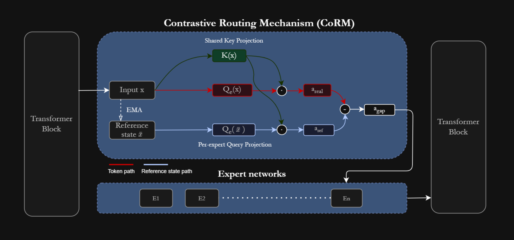
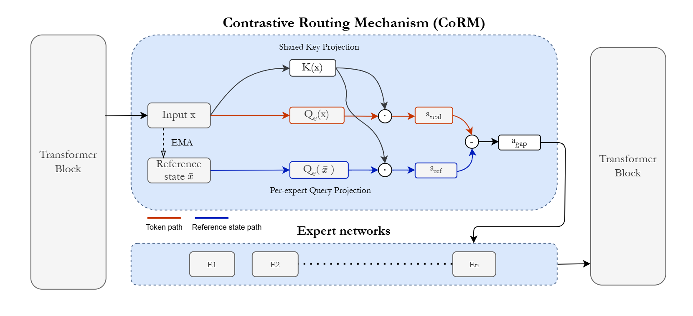

# CoRM: Contrastive Routing Mechanism

Official implementation of ["Beyond Magnitude: Contrastive Routing for Modular Mixture-of-Experts"](https://arxiv.org/abs/2609.01100).

## Abstract

> In current Mixture-of-Experts architectures, routing is performed based on representations dominated by structure shared across all tokens, limiting expert specialization.  We show that contrasting each token against an 
Exponential Moving Average of the layer's hidden states, rather than routing on absolute magnitude, concentrates the routing signal onto a low-dimensional, highly separable subspace. Building on this, we propose the Contrastive Routing Mechanism (CoRM), which scores each expert by the gap between its affinity for the incoming token and its affinity for this shared reference state, interpreted through a distinct per-expert projection. The resulting experts have routing boundaries that align with linguistic structure significantly more than the Top-$k$ baseline. Our experiments show that CoRM leads to a $+1.15\%$ (Top-1) and $+1.65\%$ (Top-2) mean absolute improvement on nine zero-shot reasoning benchmarks, at the minimal cost of $2.9\%$ added parameters and $2.6\%$ added FLOPs per token.

<p align="center">
  
  <!--  -->
</p>  

This codebase builds on [Megatron-LM](https://github.com/NVIDIA/Megatron-LM) and [ReMoE](https://github.com/thu-ml/ReMoE) and supports Data, Tensor, Pipeline, and Expert Parallelism.

## Installation

Same as Megatron-LM. See the [NGC Pytorch container](https://catalog.ngc.nvidia.com/orgs/nvidia/containers/pytorch) or install manually:

```bash
conda create -n corm python=3.11
conda activate corm
pip install torch torchvision torchaudio numpy
pip install packaging ninja
pip install flash-attn --no-build-isolation

# Apex
git clone https://github.com/NVIDIA/apex && cd apex
pip install -v --disable-pip-version-check --no-cache-dir --no-build-isolation \
    --config-settings "--build-option=--cpp_ext" --config-settings "--build-option=--cuda_ext" ./

# TransformerEngine
pip install git+https://github.com/NVIDIA/TransformerEngine.git@stable
```


## Usage

To enable CoRM routing in the MoE layer, set `--moe-router-type corm` (with `--expert-attn-size` for the router dimension). Experiment launch scripts for reproducing the results from the paper are available in the [`scripts`](scripts) directory. For the implementation, see the `CoRM` class in [`megatron/core/transformer/moe/router.py`](megatron/core/transformer/moe/router.py).

### Reproducing from Scratch

1. **Download** the Pile dataset from [Hugging Face](https://huggingface.co/datasets/monology/pile-uncopyrighted).
2. **Preprocess** with:
   ```bash
   bash data_preprocessing.sh
   ```
   Some minor modifications are required, such as the path to vocabulary files (`gpt2-vocab.json`, `gpt2-merges.txt`).
3. **Train** CoRM models (set `DATA_PATH` to your tokenized data):
   ```bash
   # Full command:
   # bash scripts/train_llama_182m_corm_top1.sh [gpus_per_node] [train_iters] [micro_batch_size] [num_experts] [granularity] [project_name]
   bash scripts/train_llama_182m_corm_top1.sh
   ```
   Top-2 and 469M models, and the dense baseline, are trained in similar ways. See the [`scripts`](scripts) directory.

### Converting to Hugging Face

```bash
python megatron_to_hf/convert_to_hf/convert_general.py --router-type corm \
    --input <megatron_checkpoint_dir> --output <hf_output_dir> \
    --model-files megatron_to_hf/CoRM_model_scripts --tokenizer <gpt2_tokenizer_dir>
```

## Checkpoints

Checkpoints are available on [Hugging Face](https://huggingface.co/ilsp/CoRM): [CoRM-182M-top1](https://huggingface.co/ilsp/CoRM-182M-top1), [CoRM-182M-top2](https://huggingface.co/ilsp/CoRM-182M-top2), [CoRM-469M-top1](https://huggingface.co/ilsp/CoRM-469M-top1).

```python
from transformers import AutoModelForCausalLM, AutoTokenizer

model_id = "ilsp/CoRM-182M-top1"
tokenizer = AutoTokenizer.from_pretrained(model_id)
model = AutoModelForCausalLM.from_pretrained(model_id, trust_remote_code=True)
```

See the [paper](https://arxiv.org/abs/2609.01100) for full results, ablations, and analysis.

## Citation

If you use this code or find our work useful, please cite:

```bibtex
@misc{xiros2026magnitudecontrastiveroutingmodular,
      title={Beyond Magnitude: Contrastive Routing for Modular Mixture-of-Experts}, 
      author={Nikolaos Xiros and Dimitrios Damianos and Maria-Eleni Zoumpoulidi and Leon Voukoutis and Vassilis Katsouros and Georgios Paraskevopoulos},
      year={2026},
      eprint={2609.01100},
      archivePrefix={arXiv},
      primaryClass={cs.CL},
      url={https://arxiv.org/abs/2609.01100}, 
}

```

## License

This project is licensed under the Apache 2.0 License — see [LICENSE](LICENSE) for details.


